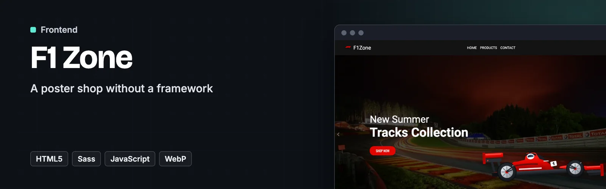
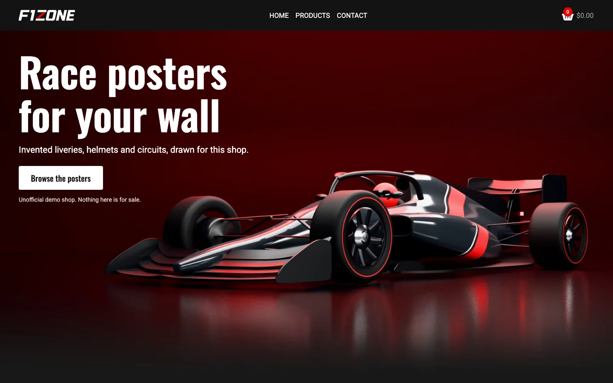
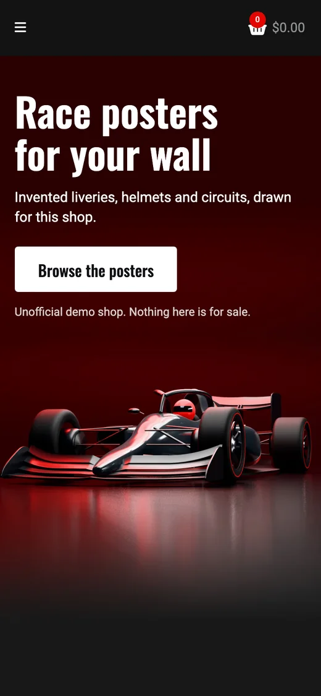
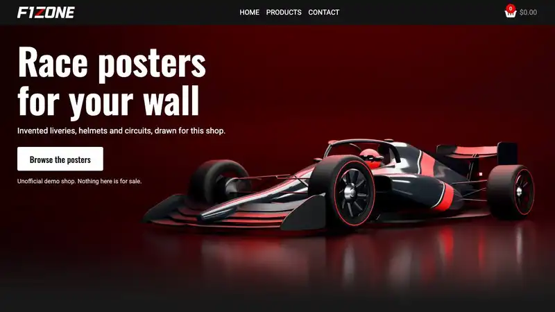

<p align="center">
  <a href="https://f1.dawidolko.pl/"></a>
</p>

# F1 Zone

> 🏎️ **A poster shop without a framework** — plain HTML, SCSS and vanilla JavaScript, with a cart that persists in the browser

**F1 Zone** is an unofficial demo poster shop for race fans. Nothing is for sale. It lists invented circuits, liveries and helmets, all made for this project, around one studio-lit race car in the hero. The catalogue lives in a JavaScript data file, a modal opens any poster full size, and the cart keeps its contents in `localStorage`, so closing the tab does not empty it.

There is no framework and no build step beyond compiling SCSS. Every behaviour — the modal, the cart, the totals in the navigation, the "already in your cart" message — is a few dozen lines of vanilla JavaScript, which is the point of the exercise.


**[Live site](https://f1.dawidolko.pl/)** · [Screenshots](#️-screenshots) · [Getting started](#-getting-started)

---

## 🎯 Key Features

- **A cart that survives the tab** — items are mirrored into `localStorage` on every change, with quantity, unit price and a running total recomputed on load.
- **Duplicate protection with feedback** — adding something already in the basket shows a message instead of silently doing nothing or adding it twice.
- **The catalogue is data** — `js/data.js` holds every poster with its id, price, stock, category, brand, code and alt text. Adding a product means adding an object.
- **A product modal built by hand** — `js/modal.js` renders the detail view from the same data, so the listing and the modal can never disagree.
- **Live totals in the navigation** — quantity and value update in the header as the cart changes, without a page reload.
- **Modern image formats** — the hero ships as AVIF with a WebP fallback and separate desktop and phone crops, and posters ship as WebP at two sizes.
- **Artwork with clear rights** — every car, helmet and circuit is invented and generated by the code in `art/source/`, so no third-party image is on the site.
- **SCSS split by concern** — colours, sizes, mixins, reset and one partial per breakpoint, compiled into a single stylesheet.
- **Alt text written per product** — it lives in the data file next to the image path, so it cannot be forgotten when a poster is added.

---

## 🎨 Design

The hero is a single studio shot: an invented graphite and red open-wheel car on a glossy floor, lit against a deep red wall, with the headline in the open space above the nose. It was rendered once with a path tracer instead of running 3D in the browser, so it looks the same on every device and costs one image instead of a WebGL library. Phones get their own crop with the car head-on under the text.

The car was modelled in code rather than downloaded, which keeps the page free of real liveries, sponsor logos, driver names and numbers. The same model, a helmet and three invented circuits supply the whole catalogue, so the shop reads as one set of posters. Oswald carries the headlines, Roboto the text, and red stays the one accent colour.

---

## 🖼️ Screenshots

<p align="center">
  
  
</p>

---

## 🎬 Demo

<p align="center">
  
</p>

---

## 🛠️ Technology Stack

| Technology      | Role                                                          |
| --------------- | ------------------------------------------------------------- |
| **HTML5**       | Semantic markup across the two pages.                         |
| **SCSS**        | Variables, mixins and per-breakpoint partials.                |
| **JavaScript**  | Cart, modal, totals and rendering — no framework.             |
| **localStorage**| Cart persistence between visits.                              |
| **Font Awesome**| Icon set.                                                     |
| **three.js**    | Offline path-traced artwork only. Not loaded by the site.     |

---

## 🚀 Getting Started

### Prerequisites

- Any static web server (or just a browser)
- Sass, if you intend to change the styles

### 1. Clone the repository

```bash
git clone https://github.com/dawidolko/F1Zone-Project-HTML-CSS-JS-SASS.git
cd F1Zone-Project-HTML-CSS-JS-SASS
```

### 2. Open it

```bash
open index.html          # or serve the directory
python3 -m http.server   # http://localhost:8000
```

### 3. Work on the styles

Edit `css/main.css`, `css/cart.css` and `css/site.css` directly. These are the files the pages load, and they have moved ahead of `sass/`, so running Sass over them would undo later fixes.

---

## ♿ Accessibility

An accessibility panel in the corner of every page changes text size, contrast, font and motion, and remembers the choice on the device. It sits on top of the markup and does not replace accessible markup.

---

## 📁 Project Structure

```
F1Zone-Project-HTML-CSS-JS-SASS/
├── index.html          # catalogue
├── cart.html           # basket and totals
├── js/
│   ├── data.js         # every poster: price, stock, category, image, alt
│   ├── main.js         # rendering and filters
│   ├── modal.js        # the product detail view
│   ├── cart.js         # cart state, localStorage, totals
│   └── footer.js
├── sass/
│   ├── main.scss       # entry point
│   ├── _colors.scss  _sizes.scss  _mixins.scss  _reset.scss
│   ├── _medium.scss  _large.scss   # breakpoints
│   └── cart/           # basket-specific styles
├── css/                # the stylesheets the pages load
├── img/                # hero renders, posters, wordmark and icons
├── art/source/         # code that generates the car, helmets, circuits and renders
├── CREDITS.md          # assets, authors and licences
└── robots.txt
```

---

## 🙏 Credits

All artwork was made for this project. The site uses the Oswald and Roboto fonts and Font Awesome Free icons under the SIL Open Font License. [CREDITS.md](CREDITS.md) lists every asset, author, source and licence.

F1 Zone is an unofficial study project and a demo shop that sells nothing. It is not connected with Formula 1, the FIA or any team, and their trademarks belong to their owners.

---

## 📄 License

MIT © [Dawid Olko](https://dawidolko.pl)

---

## 👨‍💻 Author

**Dawid Olko** · Fullstack / AI Developer

[Portfolio](https://olkodawid.dawidolko.pl) · [CV](https://cv.dawidolko.pl) · [LinkedIn](https://www.linkedin.com/in/dawidolko/) · [GitHub](https://github.com/dawidolko)
